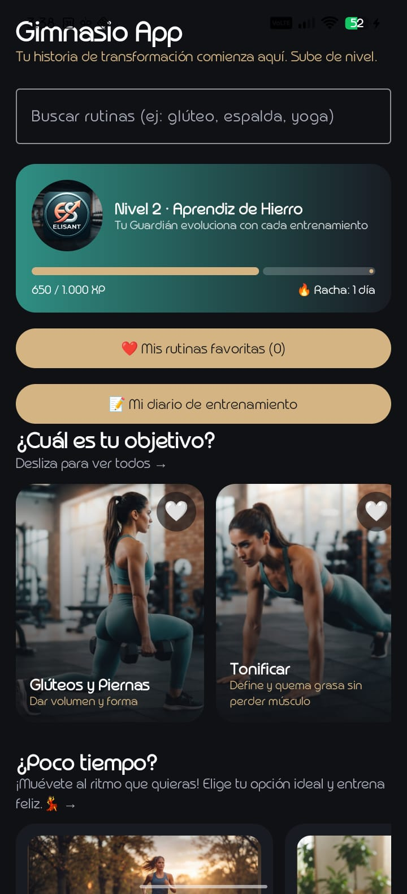
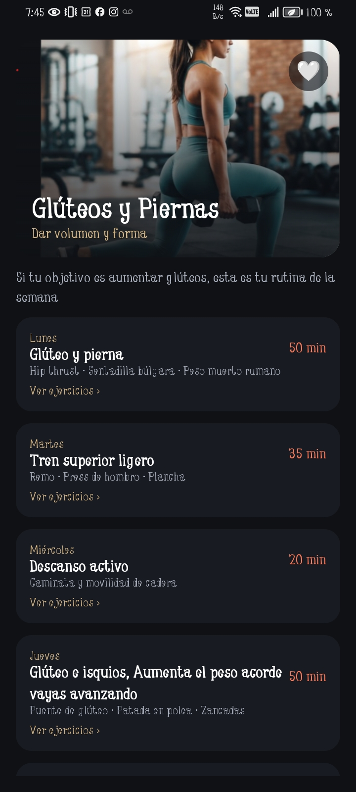
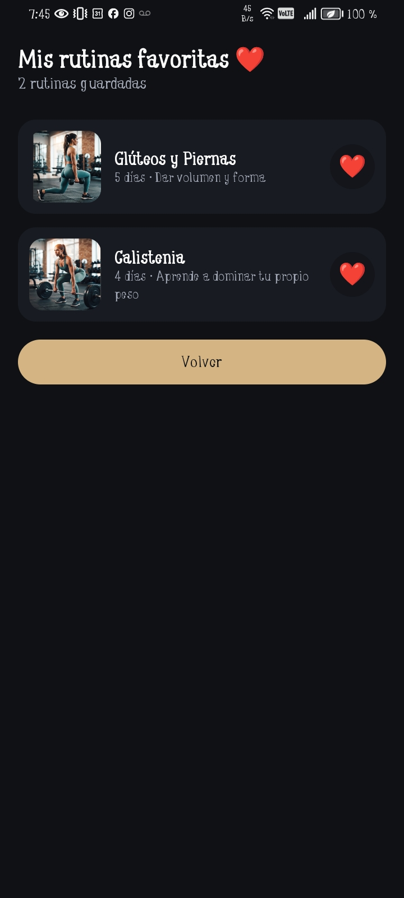
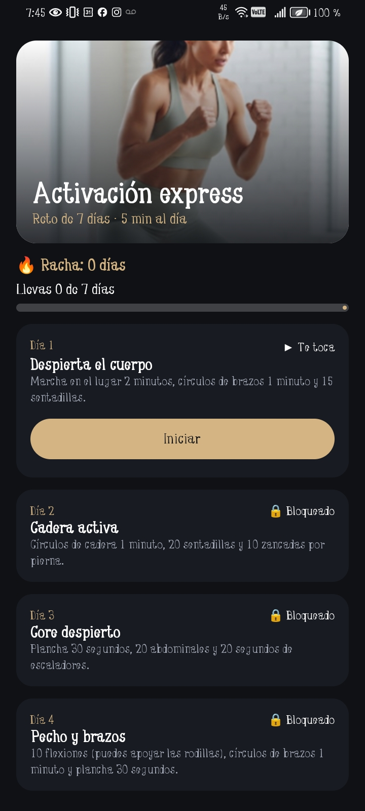
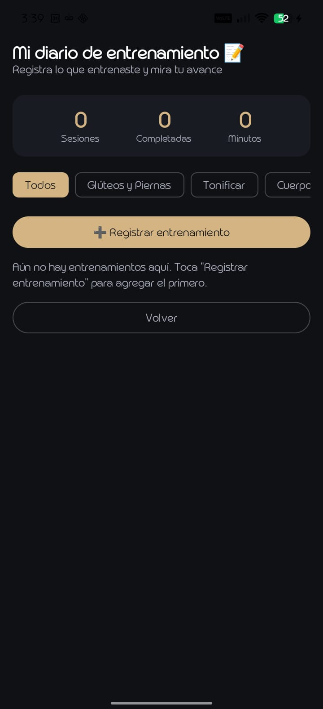
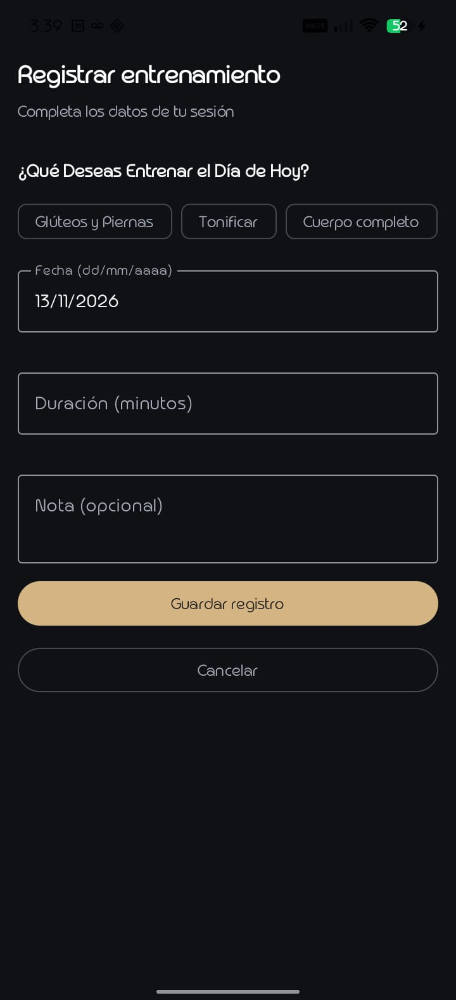

# 💪 Gimnasio App

**Tu historia de transformación comienza aquí. Sube de nivel.**

Proyecto práctico de la asignatura **Aplicativos Móviles** · Primer y segundo corte
Desarrollado con **Kotlin** y **Jetpack Compose**

---

## 1. El negocio

**Nombre:** Gimnasio App

**Descripción:** Esta aplicación va dirijida aquellas personas que quieren empezar con su vida fitness y saludable, esta App cuenta con varias opciones de entrenamiento enfocado en los objetivos que tenga las personas y tambien cuenta con rutinas cuando no se cuenya con el suficiente tiempo. 

La aplicación hace que la experiencia del gimnasio sea más personal y motivante. Cada usuario encuentra rutinas según su meta, entrena a su propio ritmo.

---

## 2. Objetivo de la aplicación

Ofrecer a los usuarios del gimnasio una herramienta móvil que les permita:

- **Encontrar rápido** la rutina que necesitan, buscando por objetivo, músculo o ejercicio.
- **Seguir un plan claro**, con la rutina dividida por días y cada ejercicio explicado.
- **Mantener la constancia** con retos cortos, incluso en los días con poco tiempo.
- **Guardar sus rutinas favoritas** para volver a ellas sin buscarlas de nuevo.
- **Entrenar según cómo se sienten** ese día, con mensajes que los motivan.

**¿Por qué estas funciones?** Muchas personas dejan el gimnasio porque no saben qué entrenar, no tienen tiempo o pierden la motivación. Cada parte de la app responde a uno de esos problemas.

---

## 3. Identidad visual

La app tiene identidad propia y está pensada para un gimnasio. Estas son las decisiones de diseño y su razón:

| Decisión | ¿Por qué? |
|---|---|
| Tema personalizado con Material 3 (`Color.kt`, `Theme.kt` y `Type.kt`) | Los colores y las tipografías se definen en un solo lugar y se aplican igual en toda la app. |
| Fotos a pantalla completa con un degradado oscuro en las tarjetas | Transmiten energía, y el degradado hace que el texto se lea bien sobre la imagen. |
| Bordes redondeados (`Redondeado`) | Dan un aspecto moderno y amigable, y se reutilizan en toda la app. |
| Semáforo de energía en verde, ámbar y rojo | Son colores que todos entienden: verde para ir con todo, ámbar para ir con calma y rojo para recuperarse. |
| Nivel, XP y racha en el perfil | El gimnasio depende de la constancia, y ver el progreso motiva a volver. |
| Emojis como íconos (🔥 ⚡ ❤️ 💪) | Dan personalidad a la app sin necesitar librerías externas. |
| Scroll vertical en el Inicio y listas horizontales | Permiten mostrar mucho contenido sin llenar la pantalla. |

---

## 4. Pantallas implementadas

La navegación se hace con **Navigation Compose**, usando `NavController` y `NavHost`.

| # | Pantalla    | Ruta | ¿Para qué sirve?                                                                                                                                                       |
|--|-------------|---|------------------------------------------------------------------------------------------------------------------------------------------------------------------------|
| 1 | **Inicio**  | `inicio` | Es la pantalla principal. Tiene el buscador, el perfil con racha, los objetivos, las actividades, el selector de energía y los retos. Desde aquí se llega a las demás. |
| 2 | **Rutina**  | `rutina/{indice}` | Muestra la rutina semanal de un objetivo, dividida por días, con el botón de favorito.                                                                                 |
| 3 | **Día**     | `dia/{objetivo}/{dia}` | Muestra los ejercicios de un día: series, repeticiones, explicación e imagen.                                                                                          |
| 4 | **Actividad** | `actividad/{indice}` | Explica una actividad para entrenar a tu ritmo (trotar, relajarse o caminar), dividida en fases con su duración y un consejo.                                          |
| 5 | **Reto Flash** | `reto/{indice}` | Permite completar un reto día a día, ver el avance y reiniciarlo.                                                                                                      |
| 6 | **Favoritos** | `favoritos` | Muestra las rutinas guardadas y permite abrirlas o quitarlas.                                                                                                          |
| 7 | **Diario** | `diario` | Historial de entrenamientos guardados en Room. Arriba muestra las estadísticas (total de sesiones, completadas y minutos acumulados) y una fila de filtros por objetivo ("Todos" o un objetivo específico); al filtrar, las estadísticas se recalculan. Cada registro muestra el objetivo, la fecha, la duración, la nota y su estado (✅ Completado o ⏳ Pendiente), y tiene tres botones: **Completar / Pendiente** (cambia el estado), **Editar** y **Eliminar** (pide confirmación antes de borrar). El botón **➕ Registrar entrenamiento** abre el formulario. Si no hay registros, muestra un mensaje invitando a crear el primero. |
| 8 | **Nuevo registro** | `diario_nuevo` | Formulario para registrar un entrenamiento: elegir el objetivo, escribir la fecha (viene con la de hoy), la duración en minutos y una nota opcional. Valida que se elija un objetivo, que la fecha no esté vacía y que la duración esté entre 1 y 300; si algo falta, muestra el error en rojo y no guarda. Tiene los botones **Guardar registro** y **Cancelar**. |
| 9 | **Editar registro** | `diario_editar/{id}` | Usa el mismo formulario, pero con los datos del registro ya cargados, para modificar el objetivo, la fecha, la duración o la nota. Se conserva el estado (completado o pendiente). Se guarda con **Guardar cambios**. |                                                                                 |
**Cómo se navega:**

- Inicio → Rutina → Día
- Inicio → Actividad
- Inicio → Reto Flash
- Inicio → Favoritos → Rutina
- Inicio → Mi Diario De Entrenamiento → Nuevo registro (o Editar registro) → de vuelta al Diario

**¿Qué se puede hacer en el Diario?**

- **Registrar** un entrenamiento nuevo con validaciones.
- **Consultar** todos los entrenamientos guardados, del más reciente al más antiguo.
- **Editar** cualquier registro.
- **Eliminar** un registro, con mensaje de confirmación para evitar borrados por error.
- **Cambiar el estado** de un registro entre Completado y Pendiente con un toque.
-**Filtrar Selección de categoría:** En la barra superior de filtros, el usuario elige el grupo muscular o tipo de rutina que planea realizar hoy (ej. *Espalda*).

**¿Por qué seis pantallas?** El mínimo eran tres, pero un gimnasio tiene mucha información (rutinas, días, ejercicios, actividades y retos). Separarla en pantallas con un propósito claro evita que la interfaz quede saturada.

---

## 5. Funcionalidades interactivas

| # | Funcionalidad | Tipo |
|---|---|---|
| 1 | Búsqueda de rutinas en vivo | **Trabajada en clase** |
| 2 | Retos Flash con progreso y racha | **Nueva** (1.er corte), ahora guardada en Room |
| 3 | Rutinas favoritas | **Nueva** (1.er corte), ahora guardadas en Room |
| 4 | Diario de entrenamiento (CRUD con Room) | **Nueva** (2.º corte) |

### Funcionalidad 1: Búsqueda de rutinas (trabajada en clase)

**¿Qué hace?** El usuario escribe en un campo de texto (`OutlinedTextField`) y los resultados aparecen debajo, filtrándose mientras escribe. Al presionar Enter se abre la primera rutina que coincide.

**¿Por qué existe?** Con seis objetivos, cada uno con una semana de rutinas y muchos ejercicios, es difícil encontrar algo solo desplazándose. Buscar "glúteo", "espalda" o "yoga" es más rápido.

**¿Cómo funciona?**

- El texto escrito se guarda en un estado: `var busqueda by remember { mutableStateOf("") }`.
- Cada vez que cambia, la función `buscarObjetivos()` (en `util/Busqueda.kt`) recorre la lista `objetivos` y revisa el nombre, la descripción, los días y los ejercicios.

### Funcionalidad 2: Retos Flash con progreso y racha (nueva)

**¿Qué hace?** Hay tres retos cortos de pocos minutos: *Activación express*, *Estiramiento salvavidas* y *Cardio relámpago*. Cada reto tiene varios días. El usuario los marca como completados, ve cuántos lleva, puede reiniciar el reto y consulta su racha total en el perfil del Inicio.

**¿Por qué existe?** La excusa más común para no entrenar es "no tengo tiempo". Un reto de 5 a 10 minutos quita esa barrera, y ver crecer la racha motiva a no dejarla.

**¿Cómo funciona?**

**¿Cómo funciona?**

- El progreso se guarda en la tabla `progreso_retos` de Room, con un registro por reto que indica cuántos días lleva.
- `GimnasioRepository` guarda el avance y `GimnasioViewModel` lo expone como `StateFlow` (`progresoRetos`). Las pantallas lo observan con `collectAsState()`.
- Como el Inicio y la pantalla del reto leen el mismo `StateFlow`, al completar un día la racha del perfil se actualiza sola.
- Los eventos `onCompletarDia` y `onReiniciar` llaman al ViewModel, que actualiza la base de datos.
- Cada día es un composable (`DiaRetoCard`) que cambia de color cuando se completa.
- Al terminar todos los días aparece el mensaje "¡Reto completado! 🏆".
- Al cerrar y volver a abrir la app, el progreso se conserva.
- Cada día es un composable (`DiaRetoCard`) que cambia de color cuando se completa.
- Al terminar todos los días aparece el mensaje "¡Reto completado! 🏆".

### Funcionalidad 3: Rutinas favoritas (nueva)

**¿Qué hace?** El usuario marca o desmarca una rutina con un corazón (❤️ / 🤍), desde las tarjetas del Inicio o desde la pantalla de la rutina. Las rutinas guardadas se ven en una pantalla aparte, y el botón del Inicio muestra cuántas hay.

**¿Por qué existe?** Las personas suelen repetir las mismas rutinas. Guardar las favoritas evita buscarlas cada vez.

**¿Cómo funciona?**

- Los índices de las rutinas favoritas se guardan en la tabla `favoritos` de Room.
- `alternarFavorito` del ViewModel agrega el registro si no existe y lo elimina si ya existe.
- Todas las pantallas leen el mismo `StateFlow` (`favoritos`), así que un corazón marcado en una pantalla aparece marcado en las demás.
- `FavoritosScreen` crea la lista con `LazyColumn` y muestra un mensaje cuando no hay favoritas.
- El composable `BotonFavorito` se reutiliza en tres lugares.
- Las favoritas se conservan al cerrar y volver a abrir la app.

### Funcionalidad 4: Diario de entrenamiento (nueva, segundo corte)

**¿Qué hace?** Permite llevar un historial de entrenamientos. El usuario puede registrar una sesión (objetivo, fecha, duración y nota), consultarla en una lista, editarla, eliminarla y marcarla como completada o pendiente. También puede filtrar el historial por objetivo y ver estadísticas que se recalculan según el filtro: total de sesiones, completadas y minutos acumulados.

**¿Por qué existe?** Para ver la constancia real: qué se entrenó, cuándo y cuánto tiempo. Antes la app solo mostraba rutinas; ahora el usuario puede guardar lo que hizo.

**¿Cómo funciona?**

- Los registros se guardan en la tabla `registros_entrenamiento` de Room, con CRUD completo en `RegistroEntrenamientoDao` (insertar, consultar, actualizar y eliminar).
- `GimnasioRepository` es el intermediario entre el DAO y el ViewModel.
- `GimnasioViewModel` combina la lista de registros con el filtro elegido (`combine`) y calcula las estadísticas. Las pantallas los observan como `StateFlow`.
- `FormularioRegistroScreen` se usa tanto para crear como para editar: si recibe un registro, carga sus datos; si no, empieza vacío.
- El formulario valida que se elija un objetivo, que la fecha no esté vacía y que la duración esté entre 1 y 300 minutos.
- Al eliminar aparece un cuadro de confirmación (`AlertDialog`) para evitar borrados por error.
- Los datos se conservan al cerrar y volver a abrir la app.

### Extra: Selector de energía con mensaje motivacional

**¿Qué hace?** El usuario elige cómo se siente hoy (😄 Con energía, 😐 Normal o 😴 Sin energía). La tarjeta elegida se resalta y aparece un mensaje motivacional distinto para cada estado.

**¿Por qué existe?** No todos los días se entrena igual. El mensaje recuerda que descansar o ir con calma también cuenta, y ayuda a mantener la constancia.

**¿Cómo funciona?** El estado `energiaSeleccionada` guarda cuál tarjeta se tocó. Cuando cambia, la tarjeta se resalta y se muestra el `mensaje` de esa opción, que está en la `data class` `EstadoEnergia`.

---

## 6. Capturas de pantalla

### Inicio


### Rutina


### Favoritos


### Reto Flash


### Diario de entrenamiento


### Reto Flash


---

## 7. Conceptos de Jetpack Compose aplicados

| Concepto | Dónde se usa |
|---|---|
| Layouts (`Column`, `Row`, `Box`) | En todas las pantallas. `Box` pone texto sobre imágenes, `Row` ordena en horizontal y `Column` en vertical. |
| Modificadores | `fillMaxWidth`, `padding`, `clip`, `weight`, `clickable` y `background`, para tamaños, espacios y distribución. |
| Componentes Material 3 | `Card`, `Button`, `Text`, `OutlinedTextField` y `LinearProgressIndicator`. |
| Listas dinámicas | `LazyRow` para objetivos y actividades, y `LazyColumn` en las pantallas de detalle y favoritos. Se generan a partir de colecciones, sin tarjetas escritas a mano. |
|`data class` | `Objetivo`, `DiaRutina`, `Ejercicio`, `Actividad`, `Fase`, `RetoFlash`, `DiaReto` y `EstadoEnergia`, en el paquete `model`. |
|  Colecciones | `objetivos` (6 rutinas), `actividades` (3), `retosFlash` (3) y `estadosEnergia` (3), en `data/DatosEstaticos.kt`. |
| Composables reutilizables | Están en `ui/components`: `ObjetivoCard`, `ActividadCard`, `RetoFlashCard`, `DiaRutinaCard`, `EjercicioCard`, `FavoritoItem`, `BotonFavorito`, `SemaforoItem`, `RegistroItem`, `ChipObjetivo` y `TituloSeccion`. |
| Estado | `remember`, `mutableStateOf` para el estado local de cada pantalla, y `StateFlow` + `collectAsState()` para los datos que vienen del ViewModel. |
| Eventos | `onClick`, `onValueChange`, `onFavoritoClick` y `onCompletarDia`. |
| Navigation Compose | `rememberNavController`, `NavHost`, `composable`, `navArgument` y `navigate`. |
| Tema Material 3 | Colores, formas y tipografías en la carpeta `ui/theme`. |
| Room | `@Entity`, `@Dao`, `@Database` y `Flow`, para guardar y observar datos en el dispositivo. |
| MVVM | `GimnasioViewModel` gestiona el estado; las pantallas solo lo muestran y le envían eventos. |
| Repository | `GimnasioRepository` es el único que se comunica con los DAOs. |


**¿Por qué el estado está en el ViewModel?** Cuando varias pantallas necesitan los mismos datos (favoritos, progreso de retos, registros del diario), lo ideal es tenerlos en un solo lugar que sobreviva a los cambios de pantalla. El ViewModel los toma de Room y los expone como `StateFlow`, así no hay copias distintas que se desincronicen y los datos se conservan al cerrar la app.
---

## 8. Estructura del proyecto

GIMNASIO/
├── app/src/main/
│   ├── java/com/example/gimnasio/
│   │   ├── MainActivity.kt          (solo arranca la app)
│   │   ├── data/                    (entidades, DAOs, base de datos Room, Repository y datos fijos)
│   │   ├── model/                   (modelos de datos)
│   │   ├── viewmodel/               (GimnasioViewModel)
│   │   ├── util/                    (búsqueda de rutinas)
│   │   ├── navigation/              (AppNavegacion)
│   │   └── ui/
│   │       ├── theme/               (Color, Theme, Type)
│   │       ├── components/          (componentes reutilizables)
│   │       └── screens/             (una pantalla por archivo)
│   └── res/drawable/                (imágenes de rutinas, actividades y retos)
├── capturas/                        (capturas para este README)
└── README.md

---

**Responsabilidades:**

- **data:** acceso a datos. Entidades y DAOs de Room, la base de datos y el Repository.
- **model:** clases que describen el contenido de la app (rutinas, ejercicios, retos).
- **viewmodel:** guarda el estado de la interfaz y la lógica; no sabe cómo se dibuja nada.
- **ui:** todo lo visual. Las pantallas usan componentes reutilizables y solo reciben datos y eventos.
- **navigation:** define las rutas entre pantallas.
- **MainActivity:** únicamente arranca el tema y la navegación.

## 9. Cómo ejecutar el proyecto

**Requisitos:** Android Studio y un emulador o un celular con Android.

1. Clona el repositorio:
   ```
   git clone https://github.com/elizabethtabordaDAM/GIMNASIO
   ```
2. Abre la carpeta del proyecto con Android Studio (File → Open).
3. Espera a que termine la sincronización de Gradle.
4. Elige un dispositivo: un emulador o tu celular con la depuración USB activada.
5. Pulsa el botón **Run ▶**.

Si aparece un error con las imágenes (`R.drawable...`), revisa que la carpeta se llame exactamente `drawable` y haz Build → Rebuild Project.

**Instalar sin compilar:** descarga el archivo `.apk` de la sección *Releases* del repositorio, cópialo al celular y ábrelo (puede pedir permitir la instalación de fuentes desconocidas).
---
## 10. Cómo probar el segundo corte

1. **Registro:** Inicio → *Mi diario de entrenamiento* → **➕ Registrar entrenamiento** → elegir objetivo, fecha y duración → **Guardar registro**.
2. **Consulta:** el registro aparece en la lista del Diario, con sus estadísticas arriba.
3. **Edición:** en el registro, tocar **Editar**, cambiar la duración o la nota y **Guardar cambios**.
4. **Cambio de estado:** tocar **Completar** (pasa a ✅ Completado) y luego **Pendiente** para devolverlo.
5. **Eliminación:** tocar **Eliminar** y confirmar en el cuadro de diálogo.
6. **Filtros y estadísticas:** tocar un objetivo en la fila de filtros y ver cómo cambian los registros y las estadísticas; tocar **Todos** para volver.
7. **Validaciones:** intentar guardar sin elegir objetivo o con duración 0 o mayor a 300; aparece el error en rojo.
8. **Favoritos y retos:** tocar el 🤍 en una rutina y completar un día en un Reto Flash.
9. **Persistencia:** cerrar la app por completo desde recientes, abrirla de nuevo y comprobar que registros, favoritos y retos siguen ahí.
## 10. Autor

**[ELIZABETH TABORDA CARDONA ]**
Aplicativos Móviles · [Universidad Tecnologica de Pereira] · [2026]