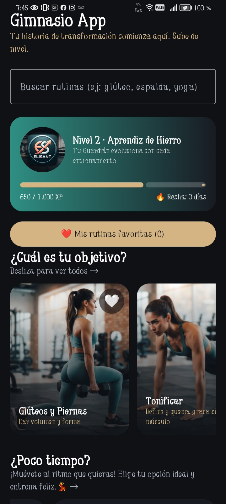
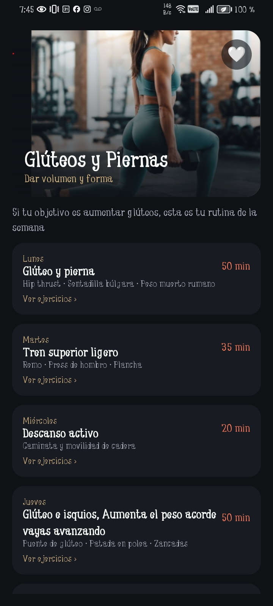
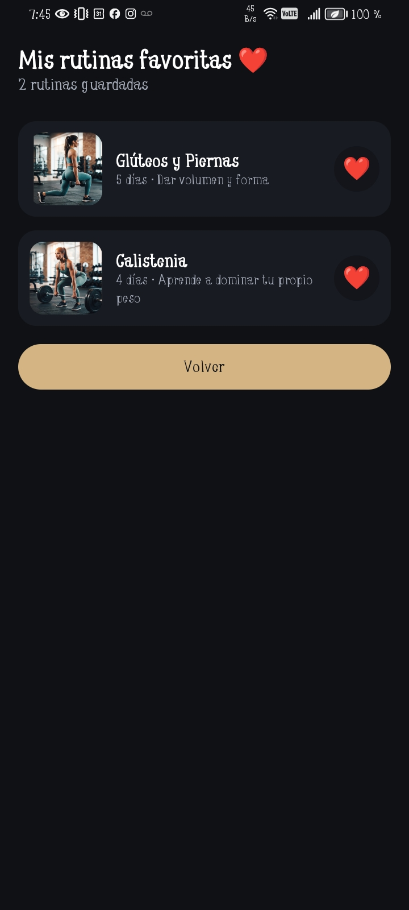
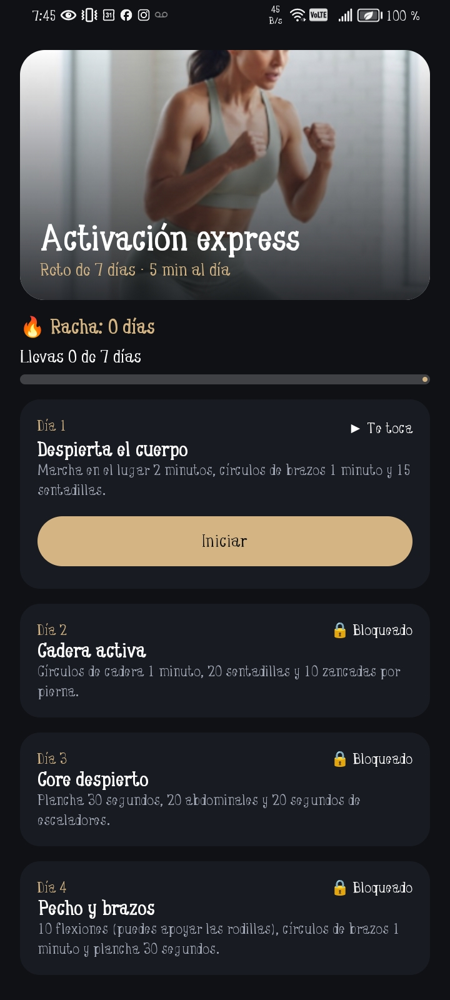

# 💪 Gimnasio App

**Tu historia de transformación comienza aquí. Sube de nivel.**

Proyecto práctico de la asignatura **Aplicativos Móviles** · Primer corte
Desarrollado con **Kotlin** y **Jetpack Compose**

---

## 1. El negocio

**Nombre:** Gimnasio App

**Descripción:** Esta aplicación va dirijida aquellas personas que quieren empezar con su vida fitness y saludable, esta App cuenta con varias opciones de entrenamiento enfocado en los objetivos que tenga las personas y tambien cuenta con rutinas cuando no se cuenya con el suficiente tiempo. 

La aplicación hace que la experiencia del gimnasio sea más personal y motivante. Cada usuario encuentra rutinas según su meta, entrena a su propio ritmo.

---

## 2. Objetivo de la aplicación

Ofrecer a los usuarios del gimnasio una herramienta móvil que les permita:

- **Encontrar rápido** la rutina que necesitan, buscando por objetivo, músculo o ejercicio.
- **Seguir un plan claro**, con la rutina dividida por días y cada ejercicio explicado.
- **Mantener la constancia** con retos cortos, incluso en los días con poco tiempo.
- **Guardar sus rutinas favoritas** para volver a ellas sin buscarlas de nuevo.
- **Entrenar según cómo se sienten** ese día, con mensajes que los motivan.

**¿Por qué estas funciones?** Muchas personas dejan el gimnasio porque no saben qué entrenar, no tienen tiempo o pierden la motivación. Cada parte de la app responde a uno de esos problemas.

---

## 3. Identidad visual

La app tiene identidad propia y está pensada para un gimnasio. Estas son las decisiones de diseño y su razón:

| Decisión | ¿Por qué? |
|---|---|
| Tema personalizado con Material 3 (`Color.kt`, `Theme.kt` y `Type.kt`) | Los colores y las tipografías se definen en un solo lugar y se aplican igual en toda la app. |
| Fotos a pantalla completa con un degradado oscuro en las tarjetas | Transmiten energía, y el degradado hace que el texto se lea bien sobre la imagen. |
| Bordes redondeados (`Redondeado`) | Dan un aspecto moderno y amigable, y se reutilizan en toda la app. |
| Semáforo de energía en verde, ámbar y rojo | Son colores que todos entienden: verde para ir con todo, ámbar para ir con calma y rojo para recuperarse. |
| Nivel, XP y racha en el perfil | El gimnasio depende de la constancia, y ver el progreso motiva a volver. |
| Emojis como íconos (🔥 ⚡ ❤️ 💪) | Dan personalidad a la app sin necesitar librerías externas. |
| Scroll vertical en el Inicio y listas horizontales | Permiten mostrar mucho contenido sin llenar la pantalla. |

---

## 4. Pantallas implementadas

La navegación se hace con **Navigation Compose**, usando `NavController` y `NavHost`.

| # | Pantalla    | Ruta | ¿Para qué sirve? |
|---|-------------|---|---|
| 1 | **Inicio**  | `inicio` | Es la pantalla principal. Tiene el buscador, el perfil con racha, los objetivos, las actividades, el selector de energía y los retos. Desde aquí se llega a las demás. |
| 2 | **Rutina**  | `rutina/{indice}` | Muestra la rutina semanal de un objetivo, dividida por días, con el botón de favorito. |
| 3 | **Día**     | `dia/{objetivo}/{dia}` | Muestra los ejercicios de un día: series, repeticiones, explicación e imagen. |
| 4 | **Actividad** | `actividad/{indice}` | Explica una actividad para entrenar a tu ritmo (trotar, relajarse o caminar), dividida en fases con su duración y un consejo. |
| 5 | **Reto Flash** | `reto/{indice}` | Permite completar un reto día a día, ver el avance y reiniciarlo. |
| 6 | **Favoritos** | `favoritos` | Muestra las rutinas guardadas y permite abrirlas o quitarlas. |

**Cómo se navega:**

- Inicio → Rutina → Día
- Inicio → Actividad
- Inicio → Reto Flash
- Inicio → Favoritos → Rutina

**¿Por qué seis pantallas?** El mínimo eran tres, pero un gimnasio tiene mucha información (rutinas, días, ejercicios, actividades y retos). Separarla en pantallas con un propósito claro evita que la interfaz quede saturada.

---

## 5. Funcionalidades interactivas

| # | Funcionalidad | Tipo |
|---|---|---|
| 1 | Búsqueda de rutinas en vivo | **Trabajada en clase** |
| 2 | Retos Flash con progreso y racha | **Nueva** |
| 3 | Rutinas favoritas | **Nueva** |

### Funcionalidad 1: Búsqueda de rutinas (trabajada en clase)

**¿Qué hace?** El usuario escribe en un campo de texto (`OutlinedTextField`) y los resultados aparecen debajo, filtrándose mientras escribe. Al presionar Enter se abre la primera rutina que coincide.

**¿Por qué existe?** Con seis objetivos, cada uno con una semana de rutinas y muchos ejercicios, es difícil encontrar algo solo desplazándose. Buscar "glúteo", "espalda" o "yoga" es más rápido.

**¿Cómo funciona?**

- El texto escrito se guarda en un estado: `var busqueda by remember { mutableStateOf("") }`.
- Cada vez que cambia, la función `buscarObjetivos()` recorre la lista `objetivos` y revisa el nombre, la descripción, los días y los ejercicios.
- La función `normalizar()` quita tildes y mayúsculas, así que "gluteo" también encuentra "Glúteos".
- Los resultados se muestran con el composable reutilizable `ResultadoBusquedaItem`.

### Funcionalidad 2: Retos Flash con progreso y racha (nueva)

**¿Qué hace?** Hay tres retos cortos de pocos minutos: *Activación express*, *Estiramiento salvavidas* y *Cardio relámpago*. Cada reto tiene varios días. El usuario los marca como completados, ve cuántos lleva, puede reiniciar el reto y consulta su racha total en el perfil del Inicio.

**¿Por qué existe?** La excusa más común para no entrenar es "no tengo tiempo". Un reto de 5 a 10 minutos quita esa barrera, y ver crecer la racha motiva a no dejarla.

**¿Cómo funciona?**

- El progreso se guarda en una lista de estado: `val progresoRetos = remember { mutableStateListOf(0, 0, 0) }`, con un contador por reto.
- Esa lista está en `AppNavegacion`, así la comparten la pantalla del reto y el Inicio. Por eso, al completar un día, la racha del perfil se actualiza sola.
- Los eventos `onCompletarDia` y `onReiniciar` modifican la lista y Compose actualiza la pantalla.
- Cada día es un composable (`DiaRetoCard`) que cambia de color cuando se completa.
- Al terminar todos los días aparece el mensaje "¡Reto completado! 🏆".

### Funcionalidad 3: Rutinas favoritas (nueva)

**¿Qué hace?** El usuario marca o desmarca una rutina con un corazón (❤️ / 🤍), desde las tarjetas del Inicio o desde la pantalla de la rutina. Las rutinas guardadas se ven en una pantalla aparte, y el botón del Inicio muestra cuántas hay.

**¿Por qué existe?** Las personas suelen repetir las mismas rutinas. Guardar las favoritas evita buscarlas cada vez.

**¿Cómo funciona?**

- La lista de favoritas es un estado: `val favoritos = remember { mutableStateListOf<Int>() }`, que guarda los índices de las rutinas.
- La función `alternarFavorito` agrega el índice si no está en la lista, y lo quita si ya está.
- Como la lista vive en `AppNavegacion`, todas las pantallas leen la misma, así que un corazón marcado en una pantalla aparece marcado en las demás.
- `FavoritosScreen` crea la lista con `LazyColumn` a partir de la colección y muestra un mensaje cuando no hay favoritas.
- El composable `BotonFavorito` se reutiliza en tres lugares.

### Extra: Selector de energía con mensaje motivacional

**¿Qué hace?** El usuario elige cómo se siente hoy (😄 Con energía, 😐 Normal o 😴 Sin energía). La tarjeta elegida se resalta y aparece un mensaje motivacional distinto para cada estado.

**¿Por qué existe?** No todos los días se entrena igual. El mensaje recuerda que descansar o ir con calma también cuenta, y ayuda a mantener la constancia.

**¿Cómo funciona?** El estado `energiaSeleccionada` guarda cuál tarjeta se tocó. Cuando cambia, la tarjeta se resalta y se muestra el `mensaje` de esa opción, que está en la `data class` `EstadoEnergia`.

---

## 6. Capturas de pantalla

### Inicio


### Rutina


### Favoritos


### Reto Flash


---

## 7. Conceptos de Jetpack Compose aplicados

| Concepto | Dónde se usa |
|---|---|
| Layouts (`Column`, `Row`, `Box`) | En todas las pantallas. `Box` pone texto sobre imágenes, `Row` ordena en horizontal y `Column` en vertical. |
| Modificadores | `fillMaxWidth`, `padding`, `clip`, `weight`, `clickable` y `background`, para tamaños, espacios y distribución. |
| Componentes Material 3 | `Card`, `Button`, `Text`, `OutlinedTextField` y `LinearProgressIndicator`. |
| Listas dinámicas | `LazyRow` para objetivos y actividades, y `LazyColumn` en las pantallas de detalle y favoritos. Se generan a partir de colecciones, sin tarjetas escritas a mano. |
| `data class` | `Objetivo`, `DiaRutina`, `Ejercicio`, `Actividad`, `Fase`, `RetoFlash`, `DiaReto` y `EstadoEnergia`. |
| Colecciones | `objetivos` (6 rutinas), `actividades` (3), `retosFlash` (3) y `estadosEnergia` (3). |
| Composables reutilizables | `ObjetivoCard`, `ActividadCard`, `RetoFlashCard`, `DiaRutinaCard`, `EjercicioCard`, `FavoritoItem`, `BotonFavorito`, `SemaforoItem` y `TituloSeccion`. |
| Estado | `remember`, `mutableStateOf` y `mutableStateListOf`, que actualizan la pantalla cuando los datos cambian. |
| Eventos | `onClick`, `onValueChange`, `onFavoritoClick` y `onCompletarDia`. |
| Navigation Compose | `rememberNavController`, `NavHost`, `composable`, `navArgument` y `navigate`. |
| Tema Material 3 | Colores, formas y tipografías en la carpeta `ui/theme`. |

**¿Por qué el estado está en `AppNavegacion`?** Cuando dos pantallas necesitan los mismos datos (los favoritos o el progreso de los retos), lo más sencillo es guardarlos en un lugar común y pasarlos a cada pantalla. Así no hay copias distintas que se desincronicen.

---

## 8. Estructura del proyecto

```
GIMNASIO/
├── app/src/main/
│   ├── java/com/example/gimnasio/
│   │   ├── MainActivity.kt      (modelos, datos, pantallas y navegación)
│   │   └── ui/theme/
│   │       ├── Color.kt         (colores)
│   │       ├── Theme.kt         (tema Material 3)
│   │       └── Type.kt          (tipografías)
│   └── res/drawable/            (imágenes de rutinas, actividades y retos)
├── capturas/                    (capturas para este README)
└── README.md
```

---

## 9. Cómo ejecutar el proyecto

**Requisitos:** Android Studio y un emulador o un celular con Android.

1. Clona el repositorio:
   ```
   git clone [(https://github.com/elizabethtabordaDAM/GIMNASIO)]
   ```
2. Abre la carpeta del proyecto con Android Studio (File → Open).
3. Espera a que termine la sincronización de Gradle.
4. Elige un dispositivo: un emulador o tu celular con la depuración USB activada.
5. Pulsa el botón **Run ▶**.

Si aparece un error con las imágenes (`R.drawable...`), revisa que la carpeta se llame exactamente `drawable` y haz Build → Rebuild Project.

---

## 10. Autor

**[ELIZABETH TABORDA CARDONA ]**
Aplicativos Móviles · [Universidad Tecnologica de Pereira] · [2026]